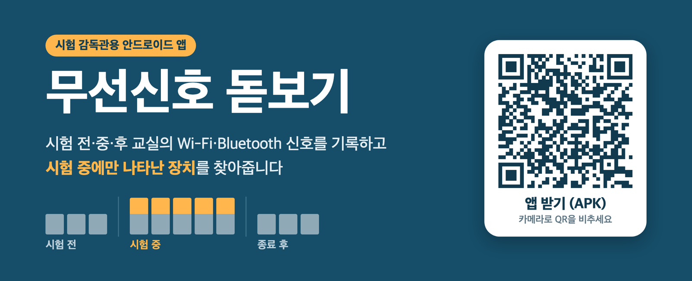
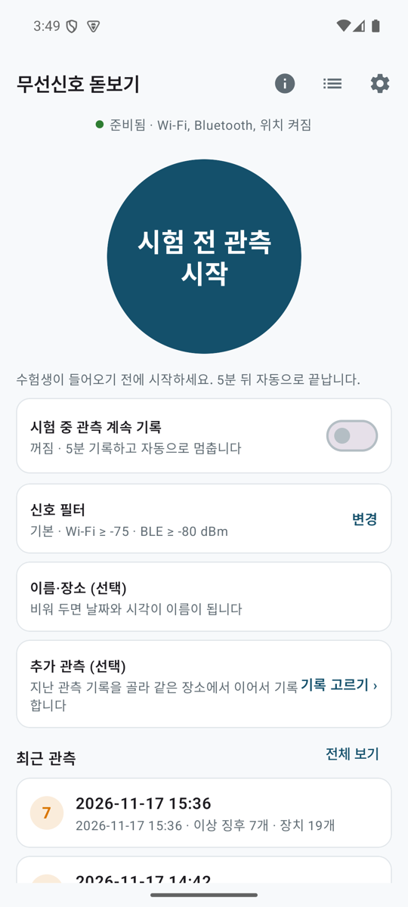
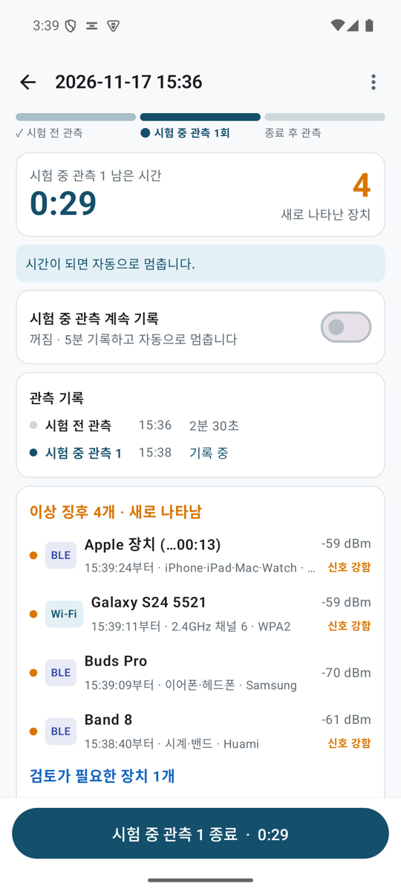
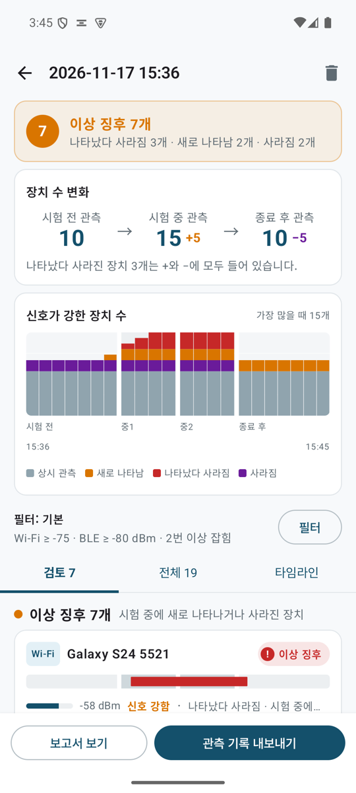
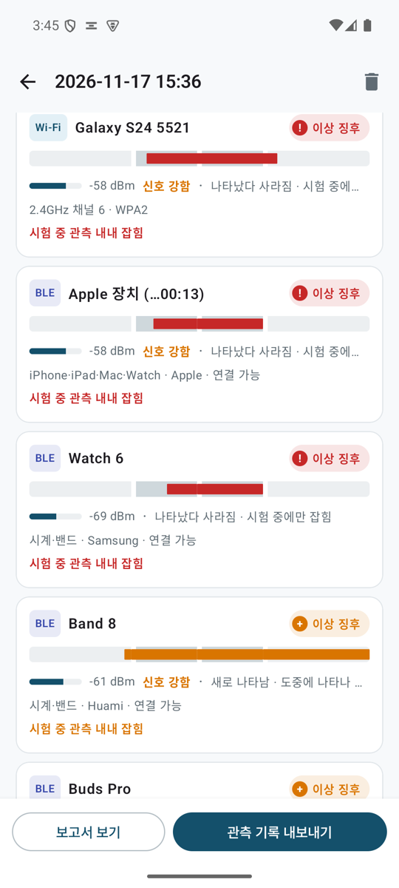

# 무선신호 돋보기

**무선신호 돋보기**는 시험 전·중·후에 교실 주변의 Wi-Fi와 Bluetooth 신호를 기록하고 비교하는 **감독관용 안드로이드 앱**입니다. 평소 교실에 없던 신호가 시험 중에 반복해서 나타나거나, 퇴실 직후까지 남아 있던 신호가 나중에 사라지는 등 감독관이 더 살펴볼 만한 변화를 보여줍니다.

AI를 악용한 시험 부정행위에 대응하기 위해 이 앱을 만들었습니다. 이상 징후를 발견하는 것도 중요하지만, **가장 큰 목적은 부정행위를 생각한 사람이 시도하기 전에 포기하도록 하는 것**입니다. 감독관이 교실의 무선 신호를 관측할 수 있다는 사실을 미리 아는 것만으로도 시도를 다시 생각할 이유가 됩니다. 11월 19일 수능을 앞두고 이 앱을 공개하는 이유입니다.

**[공식 APK 바로 받기](../../releases/latest/download/SignalLedger.apk)** · [최신 릴리스 보기](../../releases/latest)

  
  
  
  

## 수능 시험장 운영 관계자분들께 부탁드립니다

수능까지 이틀 남은 지금, 모든 시험실에 금속탐지기나 전용 무선기기 탐지 장비를 새로 배치하기는 어렵습니다. 앱 사용 여부와 관계없이, 남은 시간 동안 다음 두 가지를 꼭 점검해 주시길 간곡히 부탁드립니다.

1. **첫 수험생이 들어오기 전에 담당자가 먼저 시험실을 확인하고, 그때부터 교실을 지켜 주세요.** 일찍 도착한 수험생도 담당자가 교실을 확인한 뒤 입실하도록 해 주세요. 입실 담당자가 1교시 감독관에게 직접 인계할 때까지 자리를 지키면, 관리자가 없는 교실에 누군가 먼저 들어가 장치를 숨겨 놓는 등의 사전 준비를 막을 수 있습니다.

2. **시험 시간 동안 시험장에서 이용할 수 있는 공공 Wi-Fi를 꺼 주세요.** 학교와 통신사가 운영하는 공용망을 중단하면, 주변 Wi-Fi에 의존하는 기기로 외부와 통신하기가 어려워집니다. 개인 핫스팟이나 휴대용 공유기를 써야 한다면 별도로 장비를 준비해야 하고, 그 장비가 내는 신호도 관측될 수 있습니다. 부정행위를 준비하는 사람에게는 그만큼 시도를 포기할 이유가 하나 더 생깁니다.

## 어떻게 관측하나요?

같은 교실에서 **수험생이 들어오기 전부터 모두 나간 뒤까지** 관측하면, 원래 그곳에 있던 신호와 시험 시간에 맞춰 나타나거나 사라진 신호를 구분하는 데 도움이 됩니다.

| 관측 시점 | 사용 방법과 목적 |
|---|---|
| **시험 전** | 첫 수험생이 입실하기 전에 빈 교실에서 주변 신호를 기록합니다. 이후 관측과 비교할 기준이 됩니다. |
| **시험 중** | 시험 전에는 없던 장치가 반복해서 잡히는지 살핍니다. 긴 시험에서는 5분 단위로 여러 차례 나누어 기록할 수 있습니다. |
| **퇴실 직후** | 수험생이 모두 나간 뒤 같은 장소에서 다시 기록합니다. 입실 전과 퇴실 후에는 보이지 않고 시험 중에만 일정 횟수 이상 잡힌 장치를 이상 징후로 표시합니다. |
| **시간이 지난 뒤 추가 관측 (선택)** | **모두 퇴실한 직후에도 남아 있던 신호가 이후에 사라졌는지** 확인합니다. 시험실에 장치를 숨겨 두었다가 나중에 회수했을 가능성을 살피기 위한 관측입니다. |

앱은 관측된 **신호의 세기**와 식별 가능한 **장치 유형**(이어폰·시계·휴대전화 등)을 함께 보여줍니다. 감독관은 이 정보를 바탕으로 현장에서 무엇을 더 확인할지 판단할 수 있습니다. 신호가 나타나거나 사라졌다는 사실만으로 장치의 소유자, 회수 여부 또는 특정 수험생의 부정행위를 단정할 수는 없습니다.

## 사용법

휴대폰을 시험실 한곳에 두고, 처음부터 끝까지 같은 자리에서 관측합니다.

1. **수험생이 들어오기 전** — [시험 전 관측 시작]을 누릅니다. 5분 뒤 자동으로 끝납니다.
2. **시험이 시작된 뒤** — [시험 중 관측 시작]을 누릅니다. 5분 기록하고 멈춥니다. 필요할 때마다 [다음 시험 중 관측 시작]으로 다시 기록합니다.
3. **수험생이 모두 나간 뒤** — [종료 후 관측 시작]을 누릅니다. 5분 뒤 결과가 나옵니다.
4. **시간이 지난 뒤 (선택)** — 꼭 하지 않아도 됩니다. 시작 화면의 [추가 관측]에서 지난 기록을 골라 같은 장소에서 한 번 더 기록합니다.

결과 화면에서 이상 징후를 확인하고, [보고서 보기]와 [관측 기록 내보내기]로 보고서와 기록 파일을 남길 수 있습니다.

## 설치

- Android 12 이상 휴대폰에서 쓸 수 있습니다.
- [SignalLedger.apk](../../releases/latest/download/SignalLedger.apk)를 받아 엽니다. 이 주소는 항상 최신 버전을 가리킵니다. 처음 설치할 때 "출처를 알 수 없는 앱 설치"를 허용해야 합니다.
- 앱을 처음 열면 위치, 근처 기기, 알림 권한을 묻습니다. Android에서는 주변 Wi-Fi·Bluetooth 신호를 보려면 위치 권한이 필요합니다. 앱은 위치(GPS)를 기록하지 않습니다.
- 받은 파일이 공식 파일인지는 릴리스에 적힌 SHA-256 값과 비교해 확인할 수 있습니다.

## 관측 기록은 어디에 저장되나요?

모든 관측 기록은 **관측에 사용한 휴대폰 안에만 저장**됩니다. 필요한 경우 변조 여부를 검증할 수 있는 기록 파일과 PDF 보고서로 내보낼 수 있습니다.

## 공식 다운로드 및 11월 19일 업데이트 안내

2026년 11월 17일 현재, Google Play 정식 출시 심사가 진행 중입니다. 수능 전에 감독관과 시험장 운영 관계자분들이 앱을 설치하고 사용법을 익히실 수 있도록 GitHub Releases에서 먼저 공개합니다. 유사 앱에 주의하시고, 아래 공식 링크에서 안드로이드 설치 파일(APK)을 받아 주세요.

**11월 19일 오전, 시험 시작 전에 개선 버전을 한 차례 더 배포할 예정입니다.** 시험 당일에 다시 배포하는 이유는, 누군가 미리 공개된 앱으로 자신의 장치가 감지되는지 시험해 본 뒤 그 결과를 믿고 부정행위를 시도하는 일을 막기 위해서입니다. **현재 버전에서 감지되지 않은 신호도 시험 당일 버전에서는 감지될 수 있습니다.**

저희가 바라는 것은 이 가능성을 미리 알림으로써 부정행위를 생각한 사람이 시도하기 전에 포기하는 것입니다. 미리 설치하신 감독관께서는 **19일 오전 시험 전에** 아래 링크에서 최신 버전을 확인해 주세요.

**[무선신호 돋보기 공식 APK 바로 받기](../../releases/latest/download/SignalLedger.apk)**

